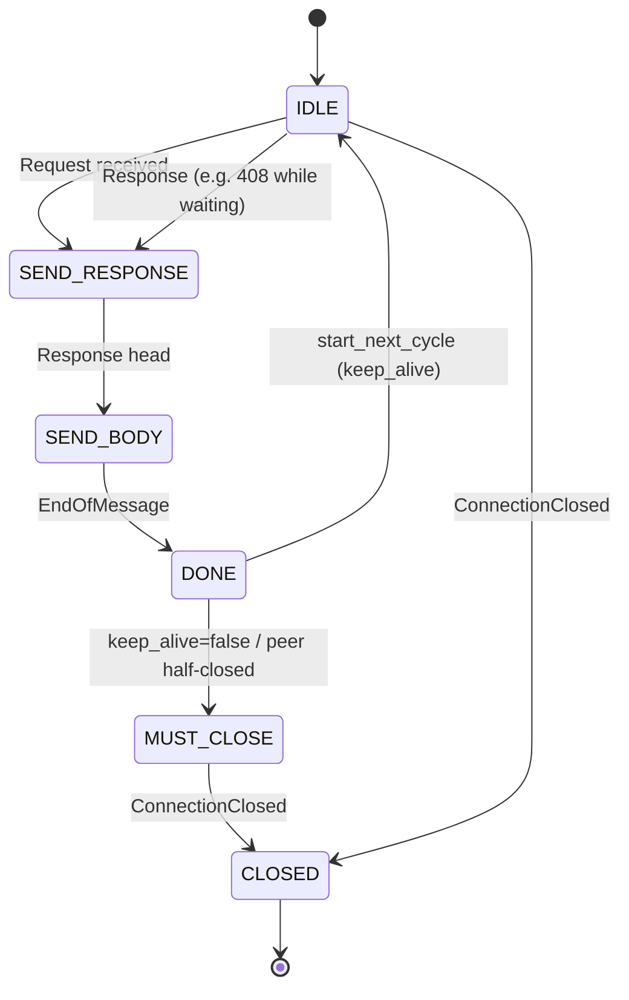

<!-- Copyright (c) 2026 Eleftherios Notas and The XIOM Authors -->
<!-- SPDX-License-Identifier: MIT OR Apache-2.0 -->
# Design: keep-alive + named deadlines (h11 / fasthttp)

Status: DESIGN (2026-10-11, PULSE session). Backlog order 2 of
`docs/PRODUCTION-REFERENCES.md`. References: `E:\repos\h11` (python-hyper,
MIT) and `E:\repos\fasthttp` (valyala, MIT), light clones; bus asks
`REL-20261011-0317-pulse` (socket options) and `-pulse-2` (deadline
receive).

Status update 2026-10-16: **Phase A IMPLEMENTED** -- bounded recv per
request (shrinking budget), poll-gated send (non-blocking; stalled
readers dropped), `408 Request Timeout` from IDLE, the three
`PULSE_*_TIMEOUT` knobs with check-config + warnings; socket-verified
on Windows and WSL (slowloris -> 408 + loop alive; write-stall dropped
at 64 KiB + loop alive). **Phase B IMPLEMENTED (same day)** --
per-connection trailing buffer, the one-way reuse latch (`Connection:
close` token / HTTP-1.0 peers / incomplete framing all close), in-order
pipelining with no data loss (pre-checked buffered requests), silent
idle expiry, and garbage-close at cycle 2; `PULSE_KEEPALIVE=0` restores
close-per-request. Smoke 119 -> 134 checks. The A+B pair freezes the API
for the PULSE Beacon package extraction.

## 1. Problem statement

PULSE today is strictly one-request-per-connection:

- Every branch of the connection handler closes the client fd after a
  single response; `Connection: close` is hardcoded in both response
  builders (`src/http.xi` -- `build_response_full`, `build_response_bytes`).
- The read path (`read_request`, `src/server.xi`) blocks in
  `socket.socket_recv` with only count/byte caps (16 KiB headers, 100
  headers, 1 MiB body, 1024 recv rounds). Nothing is wall-clock bounded:
  a slowloris client holds the single-threaded accept loop indefinitely.
- The write path (`send_all` -> stdlib `TcpStream.write_all`) loops over
  partial sends but can still block forever on a client that stops
  reading (the 270 KB favicon was the original partial-send repro).
- The stdlib exposes no socket timeouts (`socket_set_timeout`,
  `socket_set_nonblocking`, `socket_shutdown`, `socket_reuse_addr` are
  documented stubs; no `select`/`poll` in `xiom.net.*`).

Two goals, deliberately sequenced:

1. **Deadlines (safety, must land first):** bound every blocking socket
   wait so one client cannot stall the loop.
2. **Keep-alive (performance):** reuse one connection for N requests,
   which *amplifies* goal 1 -- an idle keep-alive connection without an
   idle deadline starves the single-threaded server forever.

## 2. The reference timeout model (fasthttp)

fasthttp names exactly three timeouts (`server.go` fields):

| Name | Protects against | Enforced |
|---|---|---|
| `ReadTimeout` | a client that opens/starts a request but never delivers the full request (headers + body) | `SetReadDeadline(now+ReadTimeout)` for request #1 (`server.go:2460-2466`); TLS handshake too (`1774-1778`); for keep-alive request #2+ the deadline switches to the idle value *until the first byte*, then back to `ReadTimeout` (`2514-2527`) |
| `WriteTimeout` | a client that accepts the connection but drains the response too slowly | armed only around the response write (`2761-2765`), cleared on hijack (`2863`) |
| `IdleTimeout` | an idle keep-alive connection occupying a worker slot | `SetReadDeadline(now+idleTimeout())` while waiting for the next request (`2467-2473`); `0` falls back to `ReadTimeout` (`2360-2365`) |

Expiry behavior (what clients see):

- Read deadline on request #1 / mid-request: **408 Request Timeout**
  written with `Connection: close` (`server.go:3299-3307`).
- Idle deadline on keep-alive: **silent close** -- `ErrNothingRead` is
  swallowed for request #2+ (`server.go:2601-2614`).
- Write deadline: logged and the connection dropped (usually RST/EOF to
  the client; no response can be written under the expired deadline)
  (`server.go:2812-2827`, `workerpool.go:225-235`).

Adopted for PULSE (names only; values are PULSE config):

- `PULSE_READ_TIMEOUT` (ms) -- full request (headers + body), also the
  TLS-terminating proxy's slow-client backstop. Default 30000.
- `PULSE_WRITE_TIMEOUT` (ms) -- one response write. Default 30000.
- `PULSE_IDLE_TIMEOUT` (ms) -- between keep-alive requests; falls back to
  `PULSE_READ_TIMEOUT` when unset. Default 5000.
- `0` in any of them = no deadline (dev only; `--check-config` warns).

## 3. The reference connection model (h11)

h11 implements the server as a state machine with a keep-alive flag; the
caller owns all I/O and timing (h11 has no clock -- `TimeoutError` from
the caller's socket layer is the only deadline concept; see
`h11/_connection.py:374-387`).

Rules PULSE adopts from h11 (each rule has a test we can mine,
`h11/tests/test_connection.py`):

1. **Keep-alive decision** (`h11/_connection.py:84-90`): HTTP/1.1
   default is keep-alive unless `Connection: close` (comma-token,
   case-insensitive). HTTP/1.0 default is close; `Connection: keep-alive`
   from a 1.0 peer is deliberately *not* honored (h11 simplification,
   `:72-83`) -- PULSE adopts the same simplification.
2. **Reuse requires both sides DONE** and keep-alive still true
   (`h11/_state.py:356-365`). A request whose body was not fully read is
   *not* done -- the server must either drain the body or close after
   responding (`test_pipelining`, `test_close_different_states`).
3. **MUST_CLOSE = finish the current message, then close**
   (`h11/_state.py:342-345`); the canonical loop checks it after
   responding, else calls `start_next_cycle()`.
4. **Pipelining: parse one message per cycle; buffer the rest.** After
   their side is DONE, h11 returns `PAUSED` while bytes remain buffered
   and exposes them via `trailing_data` (`h11/_connection.py:353-362,
   410-421`; `test_pipelining`). PULSE's equivalent: the per-connection
   buffer keeps unparsed bytes across cycles; never lose them.
5. **Half-close coupling** (`h11/_state.py:235-246`): if the client
   closes (EOF) while the server is DONE or IDLE, the server must close
   next; the server may still finish responding after a client
   half-close (`test_pipelined_close`).
6. **EOF between requests** = clean close; **EOF mid-message** = protocol
   error, no attempt to answer (`test_connection_drop`,
   `test_special_exceptions_for_lost_connection_in_message_body`).
7. **A server may answer 408 from IDLE** while waiting for a request
   (`h11/_state.py:207-213`, `test_408_request_timeout`) -- this is how
   the read deadline on request #1 is reported.
8. **Bounded incomplete head**: h11 caps buffered bytes of an incomplete
   line+headers at 16 KiB (`max_incomplete_event_size`,
   `h11/_connection.py:59-69, 482-490`). PULSE already has the same
   16 KiB cap in `http.header_limit_bytes`.
9. **Per-request framing recomputation** (h11 `_connection.py:93-141,
   327-334`): HEAD/204/304 force zero length; Transfer-Encoding beats
   Content-Length; a request without framing headers has an empty body;
   a response without framing headers is close-delimited. PULSE's parser
   already refuses TE+CL and unifies framing; the loop must apply it per
   request, not per connection.
10. **100-continue stays per request** (`h11/_connection.py:310-316`);
    PULSE already answers the interim inside `read_request`.

## 4. PULSE design

### 4.1 Phase A -- deadlines (blocked on stdlib)

Requires the runtime/stdlib wave queued on the bus:

- `REL-20261011-0317-pulse`: expose `SO_RCVTIMEO`/`setsockopt` (and the
  Windows bind must set `SO_REUSEADDR` to match POSIX -- graceful
  restarts), non-blocking mode, `shutdown`.
- `REL-20261011-0317-pulse-2`: a deadline-capable receive. PULSE's
  interface need: a **per-call timeout** variant such as
  `socket_recv_timeout(fd, max, timeout_ms) -> Result[Vec[UInt8], Str]`,
  where a timeout is distinguishable from peer-close (`Err` with a
  stable code/message vs the existing empty-vector EOF). A plain
  `socket_set_timeout(fd, ms)` (SO_RCVTIMEO, sticky) is also usable if
  the timing is reset per `read_request` call.

Wiring once available:

- `read_request`: apply the read deadline to the whole request
  (headers + body + chunked tail). On expiry before any byte: answer
  `408` from IDLE (rule 7). On expiry mid-request: `408` with
  `Connection: close` (fasthttp model).
- `send_all`: set a write deadline around the response write; on expiry
  log and drop (never retry a half-written response).
- Hard requirement for Phase B: the idle deadline must be enforceable
  while waiting for the first byte of request #2+ **without** busy
  polling. If the stdlib only offers recv-level timeouts, the loop
  implements the idle wait as a recv with `timeout = PULSE_IDLE_TIMEOUT`
  (first byte may arrive in the same recv; unparsed extra bytes go to the
  trailing buffer).
- Accept-loop timeouts (`accept` has no deadline; no `poll` in the
  stdlib) stay out of scope: the proxy + OS backlog cover that. Known
  limit, documented in `docs/public/security.md`.

### 4.2 Phase B -- keep-alive (on top of Phase A)

Per-connection state (minimal, struct-per-literal discipline):

- `buf: Vec[UInt8]` -- trailing/unparsed bytes across cycles (rule 4).
- `keep_alive: Bool` -- initialized true; set false by `Connection:
  close` or an HTTP/1.0 peer (rule 1).

Loop per connection:

1. If `buf` empty, wait for the first byte with the idle deadline
   (cycle > 0) or the read deadline (cycle 0). Expiry on cycle > 0:
   silent close (fasthttp model); expiry on cycle 0: `408`.
2. Read until the head is complete / body framed (existing `read_request`
   logic, refactored to append to `buf` and return a `want_more` signal
   instead of owning the socket loop).
3. Parse; on protocol error: best-effort error response if the request
   line parsed, else close (current behavior).
4. Dispatch; before responding, decide close: `keep_alive && framing
   consumed && response allows reuse`; if closing, keep `Connection:
   close` in the head (today's default), else omit it (HTTP/1.1
   default) and *never* send `keep-alive` to a 1.0 peer (rule 1).
5. Respond under the write deadline; trim `buf` by the consumed bytes.
6. `MUST_CLOSE` -> close; else next cycle.

Config: `PULSE_KEEPALIVE` (`1` default once Phase B lands; `0` restores
today's close-per-request). Response builders keep the close-by-default
signature and gain an explicit reuse flag -- the two `Connection: close`
literals in `src/http.xi` become conditional.

### 4.3 What does NOT change

- The single-threaded sequential-accept architecture.
- Body caps, header caps, TE/CL rules, 100-continue, audit, rate limit,
  CSRF, CORS, envelopes, security headers.
- Smoke scripts may keep sending `Connection: close` -- the server must
  honor a client-requested close (and those runs exercise the
  MUST_CLOSE path).

## 5. Test plan (per phase)

Phase A:

- Slowloris: open a socket, send a partial head, wait past
  `PULSE_READ_TIMEOUT` -> expect `408` (cycle 0) and the loop alive for
  the next accept (prove no stall).
- Write-stall: client stops reading a large response (`/favicon.ico`)
  -> server drops the connection within `PULSE_WRITE_TIMEOUT` and keeps
  serving.
- `--check-config` prints the three values; `0` warns.

Phase B (each maps to an h11 test to port):

- Two requests on one connection (HTTP/1.1) -> two responses, one fd.
- `Connection: close` on request 2 -> response 2 closes (rule 1).
- HTTP/1.0 peer -> closed after one response, no `keep-alive` header.
- Pipelined request 2 sent before response 1 -> both answered in order
  (trailing buffer, rule 4).
- Request with unread body + early response -> connection closed, body
  never reused as a request (rule 2).
- Client half-close after request -> response still delivered, then
  close (rule 5).
- Idle expiry -> silent close, no 408 (fasthttp model).
- Garbage bytes at cycle 2 -> protocol error close, no bleed into
  response 1 (buffer hygiene).

Every phase ends with: suites x2 + smoke both platforms (pinned stdlib),
docs + relay updates, signed commit, CI dry run.

## 6. Open questions / risks

- stdlib recv-timeout granularity: SO_RCVTIMEO is sticky per fd; the
  loop must reset the value between the idle wait and the request read,
  or adopt the per-call wrapper (preferred).
- Windows `SO_RCVTIMEO` semantics differ (returns `WSAETIMEDOUT`); the
  stdlib wrapper must normalize the error shape across platforms.
- Keep-alive interacts with the nginx front: today's proxy config sends
  `Connection: close` upstream, so Phase B shows no production gain until
  the proxy config is revisited (ops note for the next redeploy).
- C-PULSE-14 (Linux RSS growth) makes long-lived connections *more*
  interesting: keep-alive reduces per-request allocation churn but
  extends connection lifetime; re-run the RSS soak in Phase B.

## 7. Source index (for implementers)

- fasthttp: `server.go:288-312` (fields), `2460-2474`, `2514-2527`,
  `2601-2614`, `2761-2771` (enforcement), `3299-3330` (408),
  `workerpool.go:225-235` (write-timeout logging).
- h11: `_state.py:143-176` (states), `207-246` (transitions/coupling),
  `342-365` (MUST_CLOSE / start_next_cycle), `_connection.py:84-90`
  (keep-alive decision), `93-141` (framing), `353-362` (trailing_data),
  `410-433` (PAUSED / EOF), `374-387` (caller-owned timeouts).
- PULSE: `src/server.xi` accept loop + `read_request` + `send_all`;
  `src/http.xi` builders (`Connection: close` literals);
  `docs/public/security.md` (slow-client limit note).
- Bus: `REL-20261011-0317-pulse`, `-pulse-2` (stdlib, acked).
