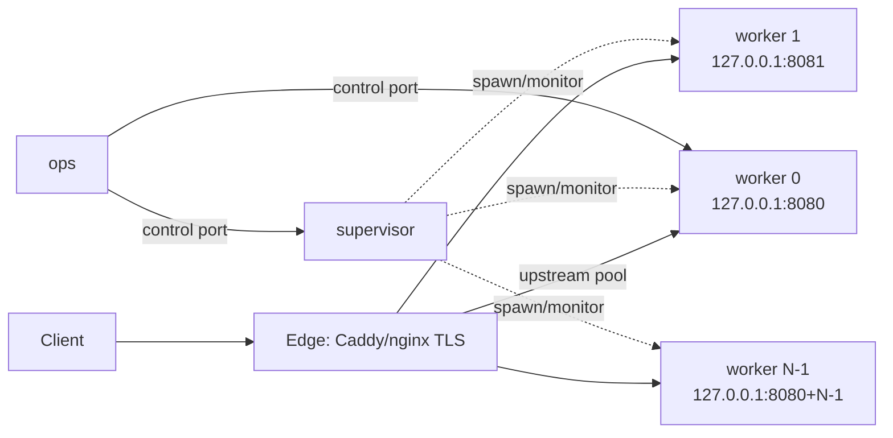
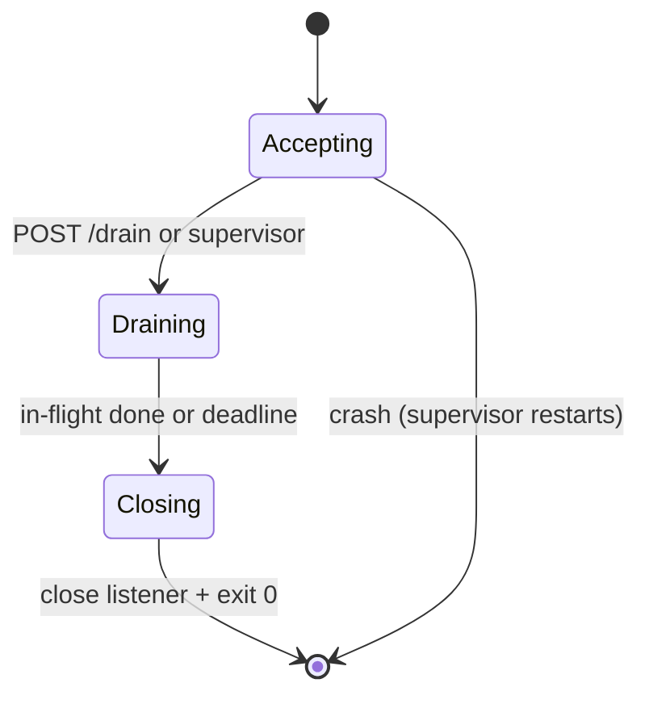
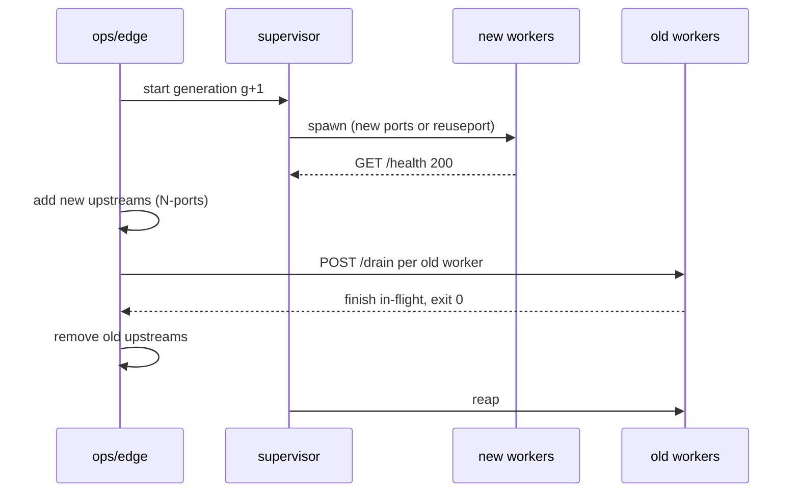

<!-- Copyright (c) 2026 Eleftherios Notas and The XIOM Authors -->
<!-- SPDX-License-Identifier: MIT OR Apache-2.0 -->
# WP4 design -- supervisor, workers, drain and reload

**Status 2026-11-06:** design ready; **not implemented**. The single-accept
loop is the measured ceiling (10 connections add no throughput), so
scale-out is a 1.0 gate. This document fixes the topology, the process model,
the drain protocol and the shared-state boundary before code lands.

**Non-goals for phase 1:** a shared session/rate/store service, native TLS,
HTTP/2, 4+ workers, and multi-worker sustained-load claims. Those follow the
SQL/KV decision and the memory gate.

## 1. Current state and constraints

- `src/server.xi` accepts one connection at a time on a blocking
  `socket_accept(fd)`; keep-alive serves cycles on that connection. A second
  connection queues. This is the measured scale ceiling.
- The stdlib (v0.65.6 / `6fdde4ee`) has the primitives:
  `socket_set_reuseport(fd, on)` (POSIX only), `socket_poll_read(fds, ms)`,
  `posix_spawn`/`posix_spawnp` (Windows maps to `CreateProcessA`),
  `process_status`/`wait_status`, `proc_is_running`, `unix_socketpair`.
- **Signal delivery is still a stub** (`os.on_signal` has an empty body;
  `raise_signal` is POSIX/no-op on Windows). Phase 1 therefore uses a
  loopback **control port** for drain/quit, not signals. Signals are a
  phase-1b convenience once the stdlib lands delivery.
- The memory floor is ~16.1 KB/req on one worker; multi-worker multiplies it.
  The 24 h/1M gates remain single-worker until the memory work and the
  shared-state boundary are settled.

## 2. Topology

Two bind modes:

| Mode | Platform | Bind | Edge |
|---|---|---|---|
| **N ports (phase 1 default)** | all five | worker `i` binds `PULSE_PORT + i` | upstream pool of N ports; add/remove on reload |
| **SO_REUSEPORT (phase 1b, Linux)** | Linux (macOS semantics differ; Windows returns Err) | every worker binds the same port after `socket_set_reuseport(fd, true)` | one upstream; the kernel distributes; a worker self-removes by closing its listener |

The **N-ports** mode is the portable baseline and the one the 1/2-worker
curve uses. Reuseport is an optimization for Linux; the design must not
require it on Windows or macOS.

## 3. Process model

`PULSE_WORKERS=N` (default 1). With `N > 1` and no `PULSE_WORKER_CHILD=1`,
the process is the **supervisor**:

1. resolve its own path from `env.args()[0]` and the platform from
   `env.FAMILY` / `os.platform()`;
2. for `i in 0..N`, spawn a child with `posix_spawn`/`posix_spawnp` and
   the environment:
   - `PULSE_WORKER_CHILD=1`
   - `PULSE_WORKER_ID=i`
   - `PULSE_PORT=<base+i>` (N-ports) or `PULSE_PORT=<base>` +
     `PULSE_REUSEPORT=1` (Linux reuseport)
   - `PULSE_CONTROL_PORT=<control-base+i>` (loopback)
   - a per-worker `PULSE_STORE_PATH` when the JSONL store is enabled
   - `PULSE_WORKER_GENERATION=<n>` for reload accounting
3. monitor with `process_status(pid)`; restart an unexpected exit with
   backoff (1 s, 2 s, 4 s, capped at 30 s; log the exit code);
4. on its own drain: ask every child to drain, wait for exit (deadline),
   then exit 0; kill survivors after the deadline.

The supervisor does **not** bind the public port and does **not** proxy
connections. Proxying through one acceptor would recreate the current
bottleneck. The edge or `SO_REUSEPORT` distributes.

An **ops unit template** (systemd `pulse@.service`, launchd, Windows service)
is an accepted alternative for phase 1: N units with `PULSE_PORT`/worker id,
the edge pool, and the same drain/reload sequence. The product supervisor is
the 1.0 deliverable; the unit template is the immediate operational path.

## 4. Drain protocol (portable)

Each worker listens on a **loopback control port** (default
`127.0.0.1:<PULSE_CONTROL_PORT>`) in addition to the public port. The main
loop polls both fds with `socket_poll_read(&fds, 250)`; the control port is
not reachable off-host.

Commands:

- `POST /drain` with `X-Pulse-Control-Token` (from
  `PULSE_CONTROL_TOKEN`): set `draining=true`, stop accepting on the public
  listener, finish the in-flight request, send `Connection: close`, close
  idle keep-alive connections, exit 0 within `PULSE_DRAIN_TIMEOUT_MS`
  (default 10000).
- `GET /health` on the control port: the supervisor/edge readiness probe.
- `POST /quit`: immediate drain, for tests/ops.

The worker never accepts a new public connection after `draining` is set,
even if a connection is already in the backlog. The edge must remove the
upstream **before** the drain request (N-ports) so new requests never queue
on a draining worker. With reuseport, closing the listener removes the
worker from the kernel group; new connections go to the remaining workers.

POSIX signals (`SIGTERM`/`SIGINT` -> the same drain state) are a phase-1b
convenience once `os.on_signal`/`signal_install` actually deliver. Do not
depend on them in phase 1; the control port is testable on all five.

## 5. Reload / zero-downtime sequence

Acceptance: with a keep-alive load generator, the reload loses **zero new
requests** routed to healthy workers; in-flight requests complete; old
workers exit 0 within the drain deadline; the edge never has a dead upstream
in rotation. Idle keep-alive connections to a drained worker are closed; the
client reconnects, which is the standard HTTP behavior and is why the edge
must drain after removing the upstream.

## 6. What scales, and what needs shared state

Multi-worker is a **stateless-first** feature. Do not claim it for stateful
routes until the shared-state boundary is implemented.

| Surface | State today | Phase 1 | Phase 2 |
|---|---|---|---|
| `/health`, `/api/version`, `/openapi.json`, static/site, `/api/echo`, plain text, calculations | stateless | safe on any worker; the 1/2-worker curve uses these | same |
| `/metrics` | per-process | scrape every worker port; label by `worker`; do not sum uptime | supervisor aggregate |
| Sessions + CSRF (`/api/session/*`, `/api/me`) | in-memory `xiom.session` | **sticky** at the edge (hash the `sid` cookie) | shared KV/SQL session store |
| Rate limit | in-memory limiter | per-worker budget = global/N, or accept N x; document | shared KV bucket |
| Event store / audit / idempotency (`/api/events`, uploads) | JSONL / files | per-worker store path; events API is per-worker; uploads on a shared filesystem | shared store/SQL; merge view |
| Game state (`/api/game/*`) | in-memory | **not multi-worker**; sticky by user/match or single worker | shared match store after the game profile |
| JWT issue/verify | stateless | safe | same |

Sticky sessions are a **documented configuration**, not a silent assumption:
the edge config must hash on the session cookie, and the operator guide must
say that round-robin breaks login/me/logout without the shared store.
The SQL/KV decision (`docs/DESIGN-SQL-SERVING.md`) gates the phase-2 shared
state; phase 1 can ship the supervisor and the stateless curve without it.

## 7. Configuration

| Variable | Default | Meaning |
|---|---|---|
| `PULSE_WORKERS` | `1` | supervisor child count |
| `PULSE_WORKER_CHILD` | unset | set by the supervisor; child mode |
| `PULSE_WORKER_ID` | `0` | worker label for logs/metrics/store path |
| `PULSE_PORT` | `8080` | base port; worker `i` uses `base+i` (N-ports) |
| `PULSE_REUSEPORT` | `0` | Linux only; same port for every worker |
| `PULSE_CONTROL_PORT` | `19000+i` | loopback drain/health control |
| `PULSE_CONTROL_TOKEN` | random at supervisor start | required on control requests |
| `PULSE_DRAIN_TIMEOUT_MS` | `10000` | in-flight/close deadline |
| `PULSE_WORKER_GENERATION` | `0` | reload generation (logs/metrics) |
| `PULSE_STORE_PATH` | config default | per-worker path when multi-worker |

Security: the control port binds `127.0.0.1` only, requires the token, and is
never exposed through the edge. The edge health check uses the public
`/health`; the control `/health` is for the supervisor.

## 8. Phased plan

**Phase 1 -- portable workers + drain (the 1.0 gate):**
1. `PULSE_REUSEPORT` option before bind (POSIX; Windows returns the
   documented Err and falls back to N ports).
2. Control port + `/drain` + `Connection: close` + drain deadline.
3. Supervisor `PULSE_WORKERS` with spawn/monitor/restart/backoff.
4. N-ports edge template (Caddy/nginx) + ops unit template.
5. 2-worker smoke and the 1/2-worker curve on a stateless endpoint.
6. Windows N-port smoke; Linux reuseport smoke.

**Phase 1b -- POSIX signals + reuseport:** wire `SIGTERM`/`SIGINT` to the
drain state once the stdlib delivers signals; test reuseport on Linux and
document the macOS semantic difference; keep N ports as the baseline.

**Phase 2 -- shared state:** sticky-session guide + shared KV/SQL sessions,
rate and store (after the SQL/KV decision); the event/upload semantics;
game state deferred.

**Phase 3 -- multi-worker proof:** 1/2/4-worker curve, drain/reload under
load, multi-worker soak; extend the WP1 memory gate to the chosen topology.

## 9. Acceptance

- **Curve:** 2 workers on distinct ports behind the edge >= 1.6x the
  1-worker throughput on a stateless CPU-bound endpoint (`/serialize`),
  same host, p99 not worse, zero errors. Record the raw run.
- **Drain:** stop accepting; finish in-flight; `Connection: close`; exit 0
  within the deadline; no new public request accepted after drain starts.
- **Reload:** zero failed new requests with the edge sequence; old workers
  exit 0; new workers healthy before the old upstreams are removed.
- **Windows:** the N-port path passes the same drain/reload smoke; the
  reuseport call returns the documented Err.
- **Stateful boundary:** the sticky-session config is tested; a non-sticky
  round-robin run is documented as unsupported for sessions; the event store
  is per-worker (or shared in phase 2).
- **No overclaim:** multi-worker is not used for the 24 h/1M memory gate
  until phase 3; the single-worker floor remains the published number.

## 10. Risks and open decisions

| Risk / decision | Mitigation |
|---|---|
| Shared-state inconsistency (sessions, rate, store, game) | stateless-first; sticky config; phase-2 shared store; never silently round-robin stateful routes |
| Signal delivery still a stub | loopback control port in phase 1; signals phase 1b |
| Supervisor restart storms | backoff, max restarts, logged exit codes, health gate |
| Edge keep-alive to a draining worker | remove the upstream before drain (N-ports), then drain; close idle connections at the deadline |
| Windows process semantics | `CreateProcessA` via `posix_spawn`; N ports; control port; no reuseport |
| Reuseport semantics on macOS | N ports as the baseline; document reuseport as Linux-only until tested |
| Port/firewall/control sprawl | base port + control-base config; loopback-only; operator guide |
| Rate limit becomes N x | per-worker budget = global/N or a shared bucket (phase 2) |
| Metrics double counting | per-worker scrape with a `worker` label; no summing uptime |

## 11. Implementation checklist

See `docs/checklists/workers.md`.

